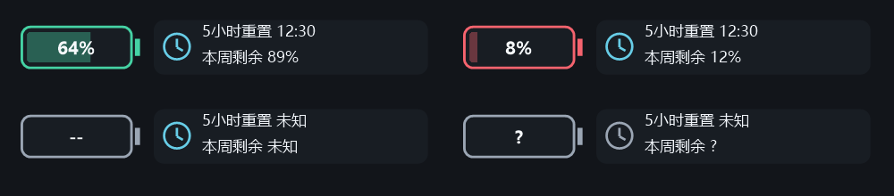

# Codex Skills 公开分享版

这里提供可下载、安装和检查的 Codex Skill。当前版本为 **codex-usage-battery-windows 1.1.2**。

## 先看许可

本项目使用[自定义《免费使用与限制转售许可》](LICENSE)，不是 MIT，也不是标准开源许可。

| 行为 | 许可范围 |
|---|---|
| 个人使用、学习、修改 | 免费允许 |
| 公司内部工作、商业项目中作为工具使用 | 免费允许 |
| 免费分享原版或修改版，保留许可与来源 | 允许 |
| 售卖 Skill、付费下载、付费资源打包、变相收费提供 Skill 本身 | 须事先取得另行书面许可 |

用工具完成的独立工作成果，不仅因使用该工具就受转售限制；具体边界以许可全文为准。许可不是技术防复制措施，也不保证具体争议中的执行结果。

## 下载与安装

- [1.1.2 Skill ZIP](dist/codex-usage-battery-windows-1.1.2.zip)
- [SHA-256 校验文件](dist/codex-usage-battery-windows-1.1.2.zip.sha256)
- [Skill 源码目录](https://github.com/zhizhongjan-cell/codex-skills-public/tree/main/skills/codex-usage-battery-windows)
- [安装说明](skills/codex-usage-battery-windows/references/installation.md)
- [1.1.2 发布验证说明](dist/codex-usage-battery-windows-1.1.2-发布验证说明.md)

把下载的 ZIP 附给自己的 Codex，输入：

```text
安装这个 Skill，同名已存在先比较，不覆盖。安装后先只读检查本机条件；部署时要求打开桌面 Codex 后电池自动显示，最后窗口关闭后退出，不设置登录常驻等待。
```

也可以把[Skill 目录网址](https://github.com/zhizhongjan-cell/codex-skills-public/tree/main/skills/codex-usage-battery-windows)发给 Codex，请它检查并安装。安装后用 `$codex-usage-battery-windows` 调用。

## 电池做什么

在前台 Codex 窗口顶部显示独立电池悬浮层，内部显示真实剩余额度，主值通常是服务返回的5小时窗口；悬停显示其他额度窗口与重置时间。电池旁的时钟显示官方5小时额度重置时间和本周剩余。优先接收官方额度通知，每30秒在同一持续连接补查，正常刷新不重复启动进程；缺失、失败或过期数据会标明。

通过 Windows 应用启动事件触发；打开 Codex 后附着，最后窗口关闭后退出。它不是原生 Codex 顶部栏插件，不修改 Codex 安装包。

适用条件：Windows 10/11 打包版 Codex Desktop、已有 ChatGPT 登录、Windows PowerShell 5.1 和 .NET Framework 编译器。查询使用自己的本机登录；不需要作者账户或新增 API Key。不同电脑、桌面版本与安装方式仍需检查兼容性。

## 版本与验证边界

- 1.1.2 将时钟旁时间改为官方5小时额度重置时间；持续连接优先消费通知，每30秒补查，普通查询错误退避但不重启进程。
- 1.1.0 的80项功能检查为历史基线；1.1.2 重新验证重置时间显示、连接复用、单元与部署边界，实际结果见本版发布说明。
- 官方接口提供数据，但本工具没有直接接管官方桌面的私有连接，不能保证与官方画面零延迟一致。
- 尚未完成下一次真实Windows重启登录或另一台电脑的实际验收。安装、部署和真实开机验收是独立步骤。
- [保留的1.0.1包](dist/codex-usage-battery-windows-1.0.1.zip)继续保留，未删除或覆盖旧版本。



本分享仓库不包含作者机器的凭据、账户额度快照、运行日志、任务XML、位置文件或编译exe。查询使用用户自己的桌面登录，不需要新增API Key。
